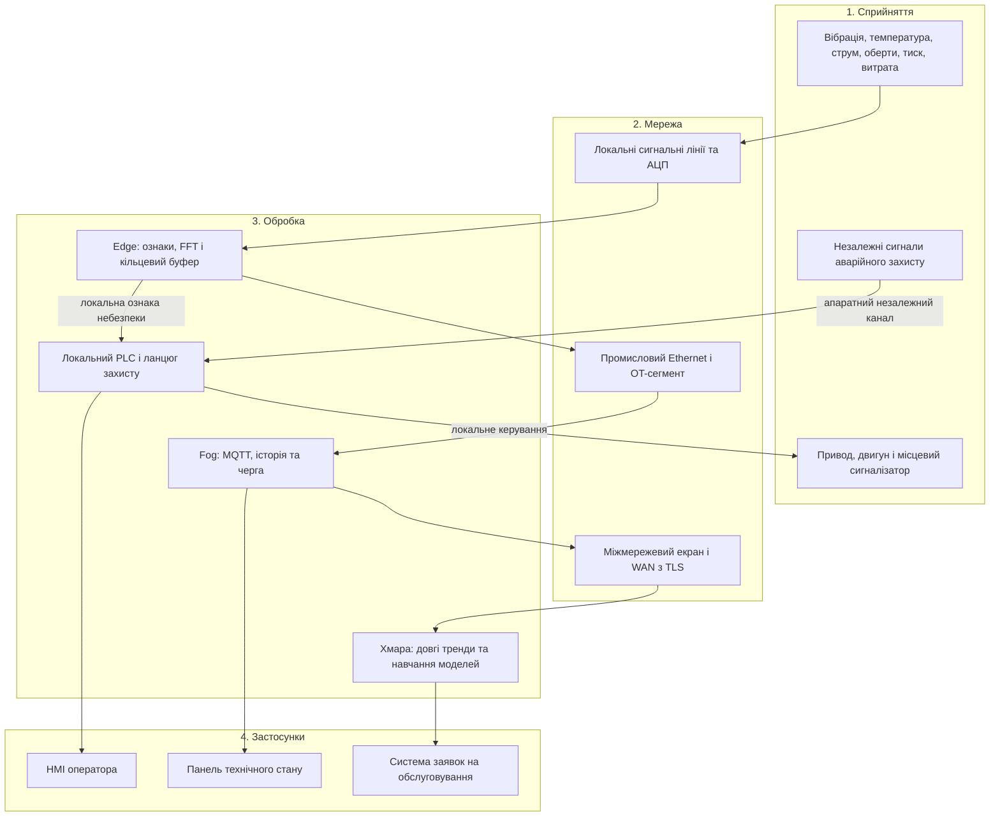
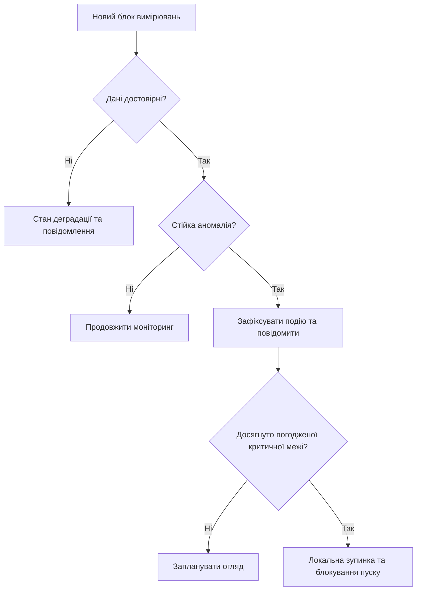

# Практична робота 1. Вступ до IoT та SMART-технологій
## Варіант 4 — Прогнозне обслуговування промислового насоса

**Дисципліна:** Технології IoT та SMART-технології  
**Виконав(ла):** ____________________  
**Дата:** 28 жовтня 2026 року  
**Тип роботи:** аналітично-проєктний документ; програмування не передбачається.

## 1. Мета й межі проєкту

Спроєктувати систему, яка виявляє ранні ознаки погіршення стану насоса,
допомагає планувати обслуговування та передає обґрунтовані попередження оператору.
Визначити склад вимірювальних пристроїв, розподіл обробки між edge, fog і хмарою,
вимоги до затримки, обсяг даних, захист і реакцію на відмови.

**Прийняті припущення:** один відцентровий насос із трифазним двигуном 15 кВт,
частотним приводом і номінальною швидкістю близько 2900 об/хв; перекачування
технічної води в невибухонебезпечному приміщенні. Швидкість може змінюватися.
Технологічний процес допускає зупинку насоса. Ці характеристики обрані для
навчального розрахунку, а не отримані з паспорта реального агрегату.

Система виконує моніторинг стану й прогнозування тенденцій. Вона **не визначає
точну дату відмови** без накопиченої історії, відомостей про ремонти та перевіреної
моделі. Апаратний захист двигуна і технологічні блокування діють незалежно
від IoT-аналітики та доступності хмари.

## 2. Ознаки зносу та вимірювані величини

| Величина | Що може означати зміна | Як інтерпретується |
|---|---|---|
| Вібраційне прискорення у трьох напрямках | Дисбаланс, неспіввісність, ослаблення кріплення, дефекти підшипника | RMS, пікове значення, crest factor, kurtosis, спектр та спектр обвідної |
| Температура підшипника і двигуна | Погіршення змащення, тертя, перевантаження | Температура, швидкість її зростання, різниця з температурою довкілля |
| Струм трьох фаз двигуна | Перевантаження, асиметрія фаз, зміна режиму | RMS кожної фази та порівняння зі швидкістю, тиском і витратою |
| Швидкість обертання | Зміна режиму роботи | Прив’язування спектральних складових до обертів, порівняння лише подібних режимів |
| Тиск на вході й виході, витрата | Нестача подачі, робота поза робочою зоною, можливі умови кавітації | Контекст для вібрації та навантаження, контроль технологічних меж |

Висока вібрація сама по собі не доводить дефект підшипника: потрібно враховувати
монтаж датчика, швидкість і навантаження. Частоти дефектів підшипника залежать
від його геометрії та обертів. Для ранньої діагностики доцільно поєднувати часові
ознаки зі спектральним аналізом і аналізом обвідної [2, 3].

## 3. Склад системи

| Пристрій / кількість | Що вимірює або робить | Де розміщено |
|---|---|---|
| Три одновісні акселерометри / 3 канали | Прискорення в радіальному горизонтальному, радіальному вертикальному та осьовому напрямках | Жорсткий вимірювальний вузол на корпусі підшипникової опори насоса |
| Синхронний АЦП і вхідні фільтри / 1 модуль | Оцифровує 3 канали вібрації по 25,6 кГц; придушує накладання спектрів | Поруч із акселерометрами в захищеному корпусі |
| Pt100 з промисловими перетворювачами / 3 | Температура опори насоса, корпусу двигуна та довкілля | На опорі, двигуні й біля агрегату |
| Ізольовані перетворювачі струму / 3 | Струм кожної фази; локально розраховується RMS | У шафі живлення двигуна |
| Датчик обертів / 1 | Частота обертання вала | Біля вала з механічним захистом; альтернатива — перевірений сигнал привода |
| Перетворювачі тиску / 2 | Тиск до та після насоса | Вхідний і вихідний трубопроводи |
| Витратомір / 1 | Подача води | Вихідний трубопровід із дотриманням вимог монтажу |
| Edge-контролер / 1 | Буферизація, FFT, ознаки, перевірка якості, локальні попередження | Біля насоса або в його шафі |
| PLC і незалежний ланцюг захисту / 1 комплект | Технологічні блокування, штатна зупинка, аварійний захист і контроль дозволу пуску | Локальна шафа керування |
| Частотний привод / 1 | Керує двигуном та виконує погоджений профіль зупинки | Шафа керування |
| Зворотний клапан і засоби захисту від гідроудару / за гідравлічним проєктом | Обмежують зворотний потік та небезпечні перехідні процеси | Трубопровідна обв’язка |
| Світлозвуковий сигналізатор і HMI / 1 комплект | Локальне попередження, стан та підтвердження оператором | Біля агрегату й на операторському посту |
| Промисловий Ethernet-комутатор і міжмережевий екран / 1 комплект | Відокремлюють OT-мережу та передають телеметрію | Шафа мережевого обладнання |
| Fog-сервер / 1 | Локальний MQTT-брокер, база даних, черга й панель | Серверна цеху |
| Хмарний сервіс / 1 логічний комплекс | Довгі тренди, аналітика історії, підготовка моделей і звіти | Віддалений центр обробки даних |
| UPS для контролерів, комутатора й шлюзу / 1 комплект | Короткочасне резервування та завершення записів; не живить двигун | Шафа автоматизації |

Для прикладу чутливого елемента можна використати ADXL1002: це **одновісний
аналоговий** акселерометр, а не готовий тривісний промисловий датчик.
Потрібні три елементи, відповідний корпус, монтаж, живлення, зовнішній АЦП
і аналогова фільтрація [4]. Вибір промислового виконання уточнюється під умови цеху.

Одна вимірювальна опора не гарантує однакової чутливості до всіх вузлів.
За результатами обстеження можна додати датчики на другій опорі та двигуні;
розрахунок нижче стосується саме **трьох каналів**.

## 4. Чотирирівнева архітектура

Використано рівні, задані в практичній: **сприйняття → мережа → обробка → застосунки**.
Це навчальне представлення. У моделі ITU-T Y.4000/Y.2060 рівні названі device,
network, service/application support та application; безпека й керування
є наскрізними функціями [1]. Edge, fog і хмара — місця виконання обробки,
а не додаткові рівні поверх чотирьох.

Схема показує **логічні рівні**, а не порядок розташування обладнання:
edge фізично стоїть біля сенсорів, до зовнішньої Ethernet-мережі.
Апаратний захист навмисно обходить MQTT і WAN. Прямого каналу команд із хмари
до привода немає. Зміна моделі або уставок проходить перевірку та локальне погодження.

## 5. Дискретизація, обсяг даних і необхідність edge

### 5.1. Вихідні припущення

- Проєктна смуга діагностичного аналізу вібрації: до 10 кГц.
- Частота дискретизації одного каналу: **25 600 відліків/с**.
- Кількість синхронних каналів: **3**.
- АЦП: 24 біти; для обробки й зберігання кожний відлік займає **4 байти**.
- Мітка часу додається на блок, а не на кожний відлік.
- Температура опитується раз на секунду; тиск, витрата та оберти — 10 разів/с.
- Струм: локальне вимірювання з достатньою смугою для RMS, але до телеметрії
  входять лише підсумки. Наведений розрахунок сирого потоку охоплює тільки вібрацію.

За теоремою дискретизації потрібна частота понад подвійну верхню частоту сигналу.
При 25,6 кГц частота Найквіста становить 12,8 кГц. Між робочою смугою до 10 кГц
та 12,8 кГц залишається перехідна область аналогового фільтра. Його реальне
придушення позасмугових складових потрібно перевірити: сама частота АЦП не
усуває aliasing. Виробник аналогового акселерометра також вимагає належного
обмеження смуги [4].

Смуга 10 кГц — компроміс цього проєкту, а не гарантія виявлення всіх дефектів.
Для конкретного підшипника інформативні резонанси можуть лежати вище, тоді
смугу, сенсор і частоту дискретизації потрібно переглянути [2].

### 5.2. Сирий потік

У розрахунках MB і GB — десяткові одиниці: 1 MB = 1 000 000 байтів.

**Швидкість:**

`R = 3 × 25 600 × 4 = 307 200 байт/с = 307,2 кБ/с = 2,4576 Мбіт/с`.

**За добу безперервної роботи:**

`V = 307 200 × 86 400 = 26 542 080 000 байтів = 26,54208 GB`.

Це корисні дані без TCP, TLS, MQTT, індексів бази та резервних копій.
Для десяти однакових насосів лише вібрація становитиме близько **265,42 GB/добу**.
Промисловий Ethernet може передати такий потік одного насоса, але зберігати
й безперервно відправляти його в хмару необов’язково: це збільшує трафік,
витрати та залежність від WAN.

### 5.3. Передавання після локальної обробки

Приймаємо одне зведене повідомлення **1000 байтів кожні 10 с**. Воно містить
ознаки всіх трьох каналів, температуру, струм, технологічні параметри,
якість даних, час, номер послідовності й версію моделі.

`86 400 / 10 = 8640 повідомлень/добу`.

`8640 × 1000 = 8 640 000 байтів = 8,64 MB/добу`.

Відношення сирої вібрації до зведеної телеметрії:

`26 542 080 000 / 8 640 000 = 3072`.

Отже, **для цього припущення** зведені повідомлення займають приблизно у
3072 рази менше місця. Це не коефіцієнт безвтратного стиснення: повна хвильова
форма в ознаках не зберігається.

Для діагностики події залишаються сирі фрагменти: 30 с до неї і 30 с після неї.

- Кільцевий буфер 30 с: `307 200 × 30 = 9 216 000 байтів = 9,216 MB`.
- Один фрагмент 60 с: `307 200 × 60 = 18,432 MB`.
- За розрахункових 20 подій/добу: `18,432 × 20 = 368,64 MB`.
- Орієнтовний бюджет передавання: `8,64 × 1,5 + 368,64 × 1,2 = 455,328 MB/добу`.

Множники 1,5 та 1,2 — інженерний резерв на протоколи й повтори, а не виміряна
властивість MQTT. Фрагменти передаються окремими файлами через HTTPS;
MQTT несе ознаки та посилання на подію. Фактичний трафік перевіряється на стенді.

Для семи діб такого буферування потрібно приблизно `0,455328 × 7 = 3,187296 GB`.
На edge резервується **8 GB під чергу та події** на промисловому носії не менше
32 GB; решта — система, журнали й запас. 20 подій/добу не є верхньою межею:
події, що перекриваються, об’єднуються, при 80 % заповнення видається попередження,
після вичерпання квоти старі некритичні фрагменти видаляються з фіксацією втрати.
Критичні метадані мають окремий резерв; нескінченне зберігання без зв’язку не обіцяється.

## 6. Розподіл обробки й вимоги до затримки

**Edge** — обчислення біля насоса. **Fog** — локальний сервер цеху.
**Хмара** — віддалена аналітика. Усі значення затримок нижче є вимогами проєкту,
а не результатами випробувань чи універсальними нормативами.

| Задача | Місце | Вимога до затримки | Чому так |
|---|---|---|---|
| Реакція на окремий аварійний вхід | Незалежний локальний PLC / захист | До 100 мс від входу до вихідного сигналу зупинки | Не залежить від мережі та FFT; фактичний час зупинки двигуна оцінюється окремо |
| Оновлення вібраційних ознак | Edge | Кожні 0,5 с після накопичення вікна | Потрібний доступ до високочастотних сирих даних |
| Підтверджене діагностичне попередження | Edge | До 3 с після стійкої зміни, достатньої для виявлення | Потрібні кілька вікон для зменшення хибних спрацювань |
| Відображення тривоги в цеху | Fog / локальна HMI | До 1 с після її формування за справної LAN | Оператор не повинен чекати WAN |
| Оновлення звичайних трендів | Fog і хмара | Телеметрія кожні 10 с; відображення до 15 с за справного каналу | Для трендів не потрібна мілісекундна реакція |
| Навчання моделі, звіти й довгі тренди | Хмара | Години або доба | Потрібні історія й обчислювальні ресурси; жорсткий реальний час відсутній |

### 6.1. Бюджет локального аналізу

Обирається вікно `N = 32 768` відліків на канал:

- тривалість вікна: `32 768 / 25 600 = 1,28 с`;
- частотний крок FFT: `25 600 / 32 768 = 0,78125 Гц`;
- нове вікно починається через 0,5 с; вікна перекриваються;
- цільовий час розрахунку ознак: не більше 100 мс;
- резерв на локальне передавання сигналу: 100 мс.

Для правила «три послідовні аномальні вікна» консервативний бюджет від початку
стійкої зміни, якщо потрібне повне нове вікно:

`0,5 + 1,28 + 2 × 0,5 + 0,1 + 0,1 = 2,98 с`, що менше проєктної межі 3 с.
Перші 0,5 с враховують несприятливий момент появи зміни відносно початку вікна.
Запас невеликий, тому під час перевірки можливе зменшення кроку вікон.

Це бюджет алгоритму, а не гарантія виявлення будь-якого пошкодження за 3 с.
Час FFT й фактичну затримку потрібно виміряти на обраному edge-контролері.
Швидкий аварійний захист не очікує завершення цих трьох вікон.

### 6.2. Що обчислюється

1. **Edge:** перевірка насичення АЦП, втрати каналу та часових міток;
   усунення постійної складової, віконна функція, FFT, RMS, пікові значення,
   crest factor, kurtosis, енергія обраних смуг, спектр обвідної.
2. **Edge:** зіставлення ознак із базовим станом для поточної швидкості та навантаження.
   За змінних обертів використовується сигнал тахометра; для складніших режимів
   передбачається аналіз порядків, а не порівняння незмінних частотних бінів.
3. **Fog:** зберігання трендів і журналу, виявлення пропусків телеметрії,
   інтерфейс оператора та повторне передавання накопиченої черги.
4. **Хмара:** порівняння довгих трендів, аналіз ремонтної історії, підготовка
   й перевірка кандидатів моделей. Нову модель спочатку оцінюють на відкладених
   даних; після погодження її підписану версію передають на edge.

Для початкового запуску достатньо правил і порівняння з базовим станом.
Прогноз залишкового ресурсу додається лише після накопичення репрезентативної
історії, перевірки похибки й опису діапазону застосовності.

## 7. Реакція на аномалію та безпечний стан

### 7.1. Рівні реагування

| Стан | Ознака | Дія |
|---|---|---|
| Норма | Ознаки відповідають справному режиму | Запис трендів і звичайна телеметрія |
| Попередження | Стійке відхилення від базового стану у трьох вікнах | Запис фрагмента, місцева сигналізація, повідомлення оператору та заявка на огляд |
| Критична діагностична аномалія | Перевищено погоджену критичну уставку, підтверджено якість даних і відповідність режиму | Локальний PLC виконує погоджену технологічну зупинку та блокує автоматичний повторний пуск |
| Апаратна аварія | Спрацював незалежний захист двигуна або технологічне блокування | Локальний захисний ланцюг діє без очікування аналітики чи хмари |
| Несправність вимірювання | Обрив, насичення АЦП, прострочені дані | Позначити «дані недостовірні», повідомити оператору; не показувати «норму» |

Уставки встановлюються за паспортами обладнання, обстеженням і базовими записами
справного агрегату. Для попередження можна дослідити відхилення від розподілу
ознак відповідного режиму, але **універсальні значення RMS або температури для
аварійного вимкнення тут не призначаються**.

### 7.2. Безпечний стан для прийнятого процесу

Безпечний стан: насос зупинений, повторний автоматичний пуск заборонений,
причина зафіксована, відновлення — лише після перевірки й ручного дозволу.
Для штатно керованої зупинки привод знижує швидкість за погодженим профілем;
перехідні тиски та гідроудар враховуються в гідравлічному проєкті.

Не можна ототожнювати команду Stop, SS1 і STO. STO прибирає крутний момент,
але двигун може зупинятися вибігом; SS1 передбачає кероване уповільнення з
подальшим STO [5]. Вибір функції, час зупинки та потрібний рівень функціональної
безпеки визначаються окремим аналізом ризику. IoT-контролер не замінює
сертифікований ланцюг, якщо він потрібен для конкретної установки.

| Відмова | Передбачена поведінка |
|---|---|
| Втрата WAN / хмари | Edge і PLC продовжують роботу; fog та edge накопичують дані; місцеві сповіщення доступні |
| Втрата fog / MQTT | Локальна діагностика й захист працюють; edge зберігає ознаки та фрагменти |
| Відмова edge | PLC бачить зникнення heartbeat; у цьому навчальному процесі після погодженого тайм-ауту 5 с виконує керовану зупинку; незалежні аварійні входи залишаються активними |
| Втрата одного діагностичного сенсора | Оператор бачить деградацію; при втраті необхідного для дозволу роботи каналу PLC зупиняє насос за погодженою процедурою |
| Втрата живлення двигуна | Насос припиняє роботу; гідравлічна обв’язка повинна витримувати перехідний процес; автоматичний перезапуск після повернення напруги заборонено |
| Втрата живлення автоматизації | UPS підтримує запис і сигналізацію орієнтовно 15 хв; його ємність уточнюється за споживанням. Незалежний захист переходить у передбачений проєктом стан без опори на програму IoT |

При відновленні WAN передаються відкладені записи з первинними часовими мітками.
Ідентифікатор пристрою та номер послідовності забезпечують виявлення дублікатів.
Прострочені команди не виконуються; самостійний пуск після відновлення зв’язку не дозволяється.

## 8. Мережа, повідомлення та зберігання

Для стаціонарного агрегату обрано дротовий Ethernet: немає потреби живити сенсор
від батареї, а керована LAN спрощує діагностику й сегментацію. Аналогові сигнали
не передаються безпосередньо MQTT: спочатку вони оцифровуються й обробляються.

Fog приймає телеметрію через **MQTT поверх TLS**. Для повідомлень про стан і тривог
використовується QoS 1: доставка може повторюватися, тому потрібна дедуплікація [6].
Підтвердження MQTT не є доказом зупинки двигуна — для цього потрібен зворотний
сигнал від PLC/привода. Сирі фрагменти завантажуються файлами з контрольною сумою.

Приклади ієрархії топіків:

- `plant/line1/pump01/features` — агреговані вимірювання;
- `plant/line1/pump01/events` — діагностичні події;
- `plant/line1/pump01/status` — стан і heartbeat;
- `plant/line1/pump01/config/proposed` — пропозиція конфігурації для перевірки.

У записі передбачено: `device_id`, час UTC, номер послідовності, оберти,
ознаки, одиниці, індикатори якості, версію алгоритму та стан зв’язку.
Локальний час і лічильник продовжують працювати без WAN. Для порядку подій
використовується монотонний час; при невпевненій синхронізації запис позначається.

## 9. Безпека

Захищається весь життєвий цикл пристрою: введення в експлуатацію, доступ,
оновлення, експлуатація та виведення з роботи. Рекомендації NIST IR 8228
використано як основу для аналізу ризиків IoT [7].

| Конкретна загроза | Наслідок для насоса | Захід протидії |
|---|---|---|
| Підміна edge-вузла та публікація «нормальних» ознак | Реальний знос приховано від оператора | Унікальний сертифікат кожного вузла, взаємна TLS-автентифікація, ACL лише на власні топіки, відкликання скомпрометованого сертифіката |
| Перехоплення телеметрії в зовнішній мережі | Розкриття режиму й графіка виробництва | TLS із перевіркою сертифіката та імені сервера; шифрування архівів, доступ за ролями |
| Повтор старого повідомлення або дублювання тривоги | Неправильна оцінка стану чи повторні заявки | Номер послідовності, мітка часу, допустимий вік даних, унікальний id події й дедуплікація |
| Несанкціонована зміна критичних уставок | Хибна зупинка або пропуск небезпечного стану | Розділення ролей перегляду й налаштування, MFA для адміністратора, погодження інженером на місці, журнал змін |
| Компрометація хмари та спроба запустити насос | Небезпечний неочікуваний пуск | Відсутній прямий канал пуску з хмари; остаточний дозвіл контролює локальний PLC; апаратні блокування не залежать від MQTT |
| Шкідлива прошивка чи неперевірена модель | Спотворена аналітика або відмова edge | Перевірка підпису оновлень, secure boot за підтримки платформи, версії, тестування й можливість відкату |
| Флуд MQTT або переповнення черги | Втрата журналу, недоступність панелі | Ліміти з’єднань і швидкості, квоти сховища, сегментація OT/IT, локальна автономність захисту |
| Фізичне від’єднання або пошкодження сенсора | Хибне відображення «низької вібрації» | Контроль обриву, насичення й правдоподібності; пломбована шафа, перевірка якості сигналу; відсутність даних не прирівнюється до норми |

Паролі та приватні ключі не зберігаються у GitHub. Персоналу надаються лише
потрібні права. Технічна телеметрія також може бути чутливою: за часом роботи,
навантаженням і ремонтами можна визначити виробничий розпорядок.

## 10. План перевірки проєктних рішень

Наведені сценарії є **планом приймальних випробувань**, а не результатами
реального запуску. Реальне обладнання в межах цієї аналітичної роботи не випробувано.

| Сценарій | Що перевірити | Критерій прийняття |
|---|---|---|
| Еталонний сигнал на вході АЦП | Частота, амплітуда, насичення й фільтрація | Збіг у межах погодженої похибки вимірювального тракту |
| Стійке відхилення на стенді / відтворення запису | Три послідовні вікна та затримка | Локальне попередження до 3 с за визначених умов тесту |
| Від’єднання WAN на годину | Автономність edge/PLC і локальна HMI | Керування та захист не зупиняються через втрату хмари; дані накопичуються |
| Повернення WAN | Первинні мітки часу та дублікати | Відкладені записи доставлено, дублікати не створюють повторних заявок |
| Від’єднання акселерометра | Виявлення недостовірних даних | Стан деградації замість «норма»; реакція за локальною процедурою |
| Зникнення heartbeat edge | Робота PLC без IoT-контролера | Погоджена зупинка після тайм-ауту, без автоматичного перезапуску |
| Аварійний вхід захисту | Незалежність від FFT, LAN і WAN | Час до вихідного сигналу відповідає вимозі; механічна зупинка вимірюється окремо |
| Хибний сертифікат або чужий топік | Автентифікація та ACL | З’єднання чи публікацію відхилено та зафіксовано |
| Накопичення понад квоту | Політика сховища | Видиме попередження й журнал втрат; немає прихованого переповнення |

## 11. Висновки

Запропоновано систему з чотирма логічними рівнями та локальною автономністю.
Вібрація, температура і струм розглядаються разом із режимом роботи, тому
зміна навантаження не повинна автоматично трактуватися як знос.

Для трьох вібраційних каналів розраховано 26,54 GB сирих даних на добу.
Edge зменшує передавання до ознак і подієвих фрагментів, забезпечує локальну
реакцію та буферизацію. Fog підтримує оператора й історію всередині цеху,
а хмара використовується для довгострокового аналізу та підготовки моделей.

Безпечна зупинка належить локальному керуванню та незалежному захисту.
Для переходу до реального впровадження потрібні паспорт насоса, обстеження
монтажу, визначення уставок і функцій безпеки, вимірювання затримок та
перевірка діагностичних алгоритмів на репрезентативних даних.

## 12. Джерела

Дата звернення до всіх наведених джерел: **28.10.2026**.

1. **ITU-T. Y.4000/Y.2060 — Overview of the Internet of things.**
   [Сторінка рекомендації](https://www.itu.int/rec/T-REC-Y.2060-201206-I).
   Використано для пояснення моделі рівнів; назви рівнів у роботі узгоджено з умовою завдання.
2. **Analog Devices. How Sensor Performance Enables Condition-Based Monitoring Solutions.**
   [Стаття](https://www.analog.com/en/resources/analog-dialogue/articles/how-sensor-performance-enables-condition-based-monitoring-solutions.html).
   Використано для вибору діагностичних величин, смуги й обмежень аналізу підшипників.
3. **Beckhoff. Bearing monitoring — Envelope spectrum.**
   [Документація](https://infosys.beckhoff.com/content/1033/tf3600_tc3_condition_monitoring/1162493835.html).
   Використано для обґрунтування аналізу обвідної та залежності частот від підшипника й обертів.
4. **Analog Devices. ADXL1001/ADXL1002 Data Sheet.**
   [PDF](https://www.analog.com/media/en/technical-documentation/data-sheets/adxl1001-1002.pdf).
   Використано для вибору прикладу аналогового сенсора та необхідності зовнішнього обмеження смуги.
5. **ABB. Typical safety functions.**
   [Офіційний опис STO та SS1](https://new.abb.com/drives/functional-safety/typical-safety-functions).
   Використано для розрізнення зупинки вибігом і керованої зупинки.
6. **OASIS. MQTT Version 5.0, 07 March 2019.**
   [Специфікація](https://docs.oasis-open.org/mqtt/mqtt/v5.0/os/mqtt-v5.0-os.html).
   Використано для моделі publish/subscribe, QoS 1 і потреби враховувати дублікати.
7. **NIST. IR 8228 — Considerations for Managing Internet of Things Cybersecurity and Privacy Risks.**
   [Остаточна публікація](https://csrc.nist.gov/pubs/ir/8228/final).
   Використано для аналізу ризиків пристроїв, даних і життєвого циклу.
8. **Mermaid. Flowcharts — Basic Syntax.**
   [Документація](https://mermaid.js.org/syntax/flowchart.html).
   Використано для оформлення двох діаграм безпосередньо в Markdown.

## 13. Подання роботи

У репозиторії зберігається цей `README.md` із Mermaid-діаграмами та історією
щонайменше трьох осмислених комітів. Програмні файли не потрібні.
Підготовлений архів містить `.git` для збереження історії. Після розпакування
й публікації локального репозиторію у власному GitHub до Google Classroom
подається **посилання на репозиторій**, а не сам архів.
